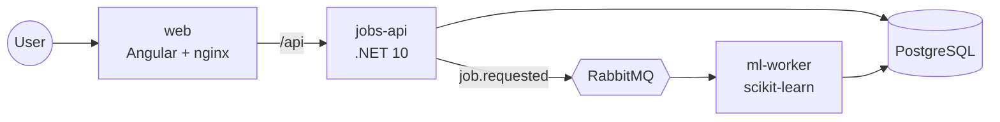

# Jobs Platform: a GitHub Actions CI/CD reference

A small, realistic three-service product used to demonstrate a **complete CI/CD setup on GitHub
Actions**: unit, integration and end-to-end tests, linting, free security scanning, and fully
automated releases. Everything runs through **one root [`justfile`](justfile)**, so every CI check
is a command you can run locally.

| | |
|---|---|
| **jobs-api** | ASP.NET Core 10 Minimal API: `GET /api/jobs`, `POST /api/jobs` (PostgreSQL + RabbitMQ) |
| **ml-worker** | Python 3.13 worker that trains a scikit-learn classifier for each job and stores its metrics |
| **web** | Angular 22 UI: a live jobs table and a dialog to start a new training job |
| **infra** | PostgreSQL 17 and RabbitMQ 4, all wired together with docker compose |



## Quick start

Prerequisites: Docker and [`just`](https://just.systems). The .NET 10 SDK, `uv` and Node 24 are
only needed to work on the code ([details](docs/local-development.md)).

```bash
just up        # build and start the whole stack
open http://localhost:8080
```

Click **New job**, pick a dataset and an algorithm, and watch the job go
`Pending → Running → Succeeded` with its accuracy and F1 score.

```bash
just           # list every recipe
just bootstrap # install all dependencies, Playwright and git hooks
just test      # unit + integration + e2e
just ci        # everything CI runs: lint, tests, security scans
```

## CI/CD at a glance

| | Workflow | Runs | `just` recipe |
|---|---|---|---|
| 🧪 | [Unit Tests · Jobs API](.github/workflows/unit-tests-jobs-api.yml) | PRs / main | `api-test-unit` |
| 🧪 | [Unit Tests · ML Worker](.github/workflows/unit-tests-ml-worker.yml) | PRs / main | `worker-test-unit` |
| 🧪 | [Unit Tests · Web](.github/workflows/unit-tests-web.yml) | PRs / main | `web-test-unit` |
| 🔗 | [Integration Tests · Jobs API](.github/workflows/integration-tests-jobs-api.yml) | PRs / main | `api-test-integration` |
| 🎭 | [E2E Tests · Web (Playwright)](.github/workflows/e2e-tests-web.yml) | PRs / main | `web-test-e2e` |
| 🧹 | [Lint & Format · Jobs API](.github/workflows/lint-jobs-api.yml) | PRs / main | `api-lint` |
| 🧹 | [Lint & Format · ML Worker](.github/workflows/lint-ml-worker.yml) | PRs / main | `worker-lint` |
| 🧹 | [Lint & Format · Web](.github/workflows/lint-web.yml) | PRs / main | `web-lint` |
| 🔑 | [Security · Secret Scan (Gitleaks)](.github/workflows/security-secret-scan.yml) | PRs / main / weekly | `security-secrets` |
| 🛡️ | [Security · SAST (Semgrep)](.github/workflows/security-sast.yml) | PRs / main / weekly | `security-sast` |
| 🛡️ | [Security · Dependency Scan (Trivy)](.github/workflows/security-dependency-scan.yml) | PRs / main / daily | `security-deps` |
| 🛡️ | [Security · Container & IaC Scan (Trivy)](.github/workflows/security-container-scan.yml) | PRs / main / daily | `security-images` |
| 🚀 | [Release · Release Please](.github/workflows/release-please.yml) | main | – |
| 🚀 | [Release · Publish Images](.github/workflows/release-publish-images.yml) | on release | `images-publish` |
| 📋 | [Repo · PR Title Check](.github/workflows/repo-pr-title.yml) | PRs | – |
| 📋 | [Repo · Workflow Lint](.github/workflows/repo-workflow-lint.yml) | `.github` changes | `lint-workflows` |

Plus **pre-commit hooks** (format checks + unit tests for the apps you touched, Gitleaks,
Conventional Commit messages) and **Dependabot** for NuGet, uv, npm, Docker and Actions.

## 🚀 Releasing

Releases are automated with **release-please**. Merge PRs with Conventional Commit titles, then
merge the release PR it maintains. That tags `vX.Y.Z`, writes the changelog, and publishes all
images to GHCR with SBOMs.
**→ Read the [release process](docs/release.md).**

## Documentation

| Document | Contents |
|---|---|
| [Release process](docs/release.md) | how versions are chosen, the release PR, one-time setup, hotfixes, troubleshooting |
| [CI with GitHub Actions](docs/ci.md) | workflow catalogue, naming, conventions, path filters, private-repo notes |
| [Security checks](docs/security.md) | Gitleaks, Semgrep, Trivy, zizmor: what runs when, handling findings |
| [Architecture](docs/architecture.md) | components, job lifecycle, data model, messaging, design decisions |
| [Local development](docs/local-development.md) | prerequisites, running pieces natively, hooks, troubleshooting |
| [Contracts](contracts/README.md) | RabbitMQ message schema and topology |
| [Contributing](CONTRIBUTING.md) | branch, commit and PR conventions |

## Repository layout

```
apps/
  jobs-api/        .NET solution: src/JobsApi, tests/{UnitTests,IntegrationTests}, Dockerfile
  ml-worker/       uv project: src/ml_worker, tests/unit, Dockerfile
  web/             Angular app: src/app, e2e (Playwright), nginx config, Dockerfile
contracts/         JSON Schema for RabbitMQ messages (shared by producer and consumer tests)
deploy/compose/    docker compose stack for local runs and e2e tests
docs/              the documents above
.github/
  workflows/       16 workflows, named "Category · Component"
  actions/         composite setup actions per toolchain
  dependabot.yml
justfile           the single entry point for build, test, scan and release
docker-bake.hcl    image definitions (scanned in CI, published on release)
release-please-config.json, .release-please-manifest.json, version.txt
```
