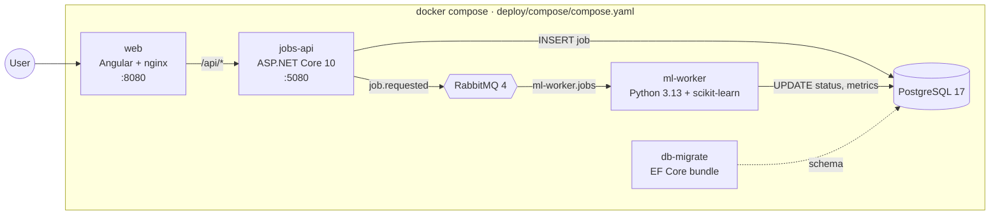
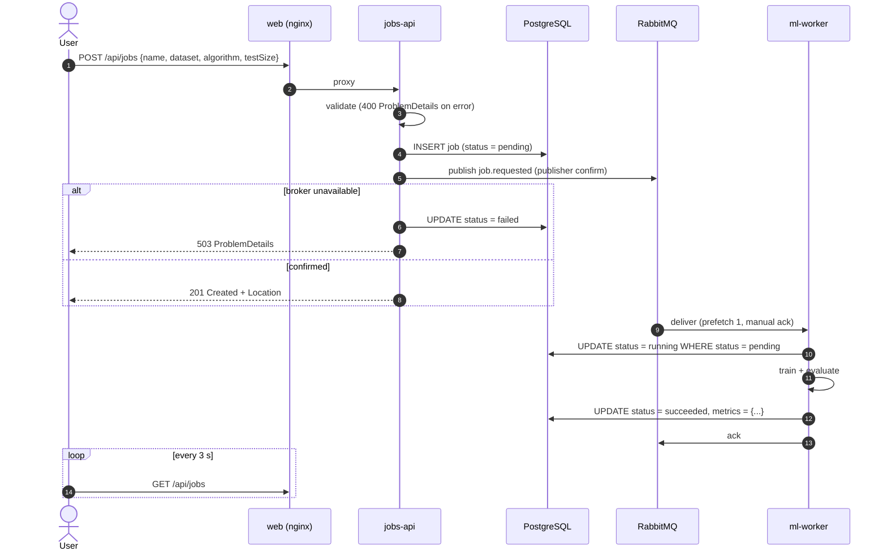
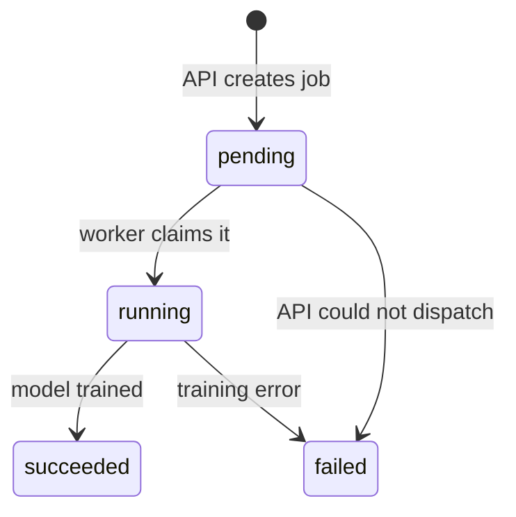

# Architecture

The product is intentionally small. Its job is to give the CI/CD pipeline three
realistic, differently-built components to test, scan and release.

| Component | Path | Stack | Responsibility |
|---|---|---|---|
| **jobs-api** | [`apps/jobs-api`](../apps/jobs-api) | .NET 10, Minimal APIs, EF Core + Npgsql, RabbitMQ.Client | Validates and stores jobs, publishes `job.requested`, serves job state |
| **jobs-api-migrator** | same Dockerfile, `migrator` target | EF Core migration bundle | Applies schema migrations once, before the API and worker start |
| **ml-worker** | [`apps/ml-worker`](../apps/ml-worker) | Python 3.13, uv, pika, psycopg 3, scikit-learn | Trains the requested model and records metrics |
| **web** | [`apps/web`](../apps/web) | Angular 22, Angular Material, nginx-unprivileged | Jobs table (polling) and a "new job" dialog; nginx proxies `/api` |
| **contracts** | [`contracts`](../contracts) | JSON Schema | The message contract shared by producer and consumer |

## What a job does

A job **trains and evaluates a classifier** on one of scikit-learn's bundled datasets, so it
needs no downloads and is deterministic thanks to a fixed seed:

- **Datasets:** `iris` (150 × 4, 3 classes), `wine` (178 × 13, 3 classes),
  `breast_cancer` (569 × 30, 2 classes)
- **Algorithms:** `logistic_regression`, `random_forest`, `svm`, each preceded by a `StandardScaler`
- **`testSize`:** the stratified hold-out fraction, 0.1–0.5
- **Result:** `accuracy`, `f1Macro`, `trainSamples`, `testSamples`, `durationMs`

## Job lifecycle

## Data model

Table `jobs`, owned by the API (EF Core migrations, snake_case columns):

| Column | Type | Notes |
|---|---|---|
| `id` | `uuid` | UUID v7 (time-ordered) |
| `name` | `varchar(100)` | trimmed, 3–100 characters |
| `dataset`, `algorithm` | `varchar(32)` | snake_case enum values |
| `test_size` | `double precision` | check constraint 0.1–0.5 |
| `status` | `varchar(16)` | check constraint `pending/running/succeeded/failed` |
| `metrics` | `jsonb` | written by the worker |
| `error` | `varchar(2000)` | failure reason |
| `created_at`, `started_at`, `completed_at` | `timestamptz` | |

## Messaging

See [`contracts/README.md`](../contracts/README.md) for the topology. The highlights:

- Durable **quorum** queue `ml-worker.jobs` with a dead-letter exchange. Messages that fail
  validation are rejected straight to `ml-worker.jobs.dlq`, and messages hitting transient
  errors are requeued until the quorum queue's delivery limit dead-letters them.
- The API publishes with **publisher confirms** and `mandatory`, so a job is only reported as
  created once the broker has accepted and routed the message.
- The worker is an **idempotent consumer**: `UPDATE … WHERE status = 'pending'` means a
  redelivered message is skipped instead of retraining.
- **Contract tests on both sides** validate the producer's serialized message and the
  consumer's model against the same JSON Schema.

## Design decisions

| Decision | Rationale |
|---|---|
| Migrations run in a one-shot `db-migrate` container (EF Core bundle), not at API startup | Multiple API replicas never race on migrations, and the runtime image needs no DDL rights. The same bundle works in any environment |
| The API owns the schema; the worker writes plain SQL | One source of truth for DDL; the worker only touches status/metrics columns |
| HTTP JSON is camelCase, messages and DB are snake_case | Idiomatic for Angular and for Python respectively; enum *values* are snake_case everywhere |
| nginx serves the SPA and proxies `/api` | Same origin, so no CORS, and the CSP can stay strict (`connect-src 'self'`) |
| Built-in .NET 10 Minimal API validation (DataAnnotations) | No extra validation library; errors are standard `ValidationProblemDetails` |
| No MassTransit / MediatR / FluentAssertions | They moved to commercial licences; the plain libraries are enough here |
| Polling instead of WebSockets/SSE | The simplest thing that works for a demo; easy to test |
| *Not* a transactional outbox | Dispatch failures are surfaced as `failed` jobs. An outbox is the next step if "at least once" delivery must be guaranteed |
