# Release process

Releases are fully automated with [release-please](https://github.com/googleapis/release-please).
Nobody edits version numbers or the changelog by hand: they are derived from the
[Conventional Commits](https://www.conventionalcommits.org/) that land on `main`.

The whole product shares **one version**: a release `v1.4.0` contains `jobs-api`,
`jobs-api-migrator`, `ml-worker` and `web` images, all tagged `1.4.0`.

## TL;DR

1. Give your PR a Conventional Commit title, e.g. `feat(api): add job priority`.
   **Repo · PR Title Check** enforces this.
2. **Squash-merge** the PR. The PR title becomes the commit message on `main`.
3. **Release · Release Please** opens or updates a PR called
   `chore(release): release X.Y.Z` with the version bump and the new `CHANGELOG.md` section.
4. When you want to ship, **merge the release PR**. This:
   - tags `vX.Y.Z` and creates a GitHub Release with the changelog as release notes
   - builds and pushes all images to `ghcr.io/14stack/git_workflows_example/*:X.Y.Z`
     (plus `X.Y` and `latest`) with SBOM and provenance attestations
   - attaches CycloneDX SBOMs to the GitHub Release

```mermaid
flowchart LR
    A[PR with conventional title] -->|squash merge| B(main)
    B -->|Release · Release Please| C[Release PR<br/>chore&#40;release&#41;: release X.Y.Z]
    C -->|more merges to main| C
    C -->|merge| D[tag vX.Y.Z + GitHub Release]
    D -->|Release · Publish Images| E[GHCR images X.Y.Z, X.Y, latest<br/>SBOM + provenance]
    D --> F[CycloneDX SBOMs attached to the release]
```



## How the next version is chosen

| Commit (PR title) | Example | Bump before 1.0 | Bump from 1.0 | In changelog |
|---|---|---|---|---|
| `feat` | `feat(web): show F1 score` | minor | minor | Features |
| `fix` | `fix(worker): retry on DB disconnect` | patch | patch | Bug Fixes |
| `perf` | `perf(api): index created_at` | patch | patch | Performance Improvements |
| `deps` | `deps: bump scikit-learn to 1.9.2` (Dependabot) | patch | patch | Dependencies |
| `revert` | `revert: feat(web): show F1 score` | patch | patch | Reverts |
| `!` or a `BREAKING CHANGE:` footer | `feat(api)!: rename testSize to holdout` | **minor** | **major** | Features + Breaking changes |
| `docs`, `refactor`, `test`, `build`, `ci`, `chore` | `ci: cache Trivy DB` | none | none | hidden |

- **Before 1.0**, `bump-minor-pre-major` is on, so a breaking change bumps the minor version
  instead of jumping to 1.0.0.
- Hidden types still land on `main`, but on their own they never trigger a release.
- Allowed scopes are `api`, `worker`, `web`, `contracts`, `deploy`, `deps`, `deps-dev`, `ci`,
  `release`, `security` and `docs`. Scopes are optional.

## What gets versioned

`.release-please-manifest.json` is the source of truth. The release PR updates:

| File | How |
|---|---|
| `version.txt`, `CHANGELOG.md` | release-please `simple` strategy |
| `apps/jobs-api/Directory.Build.props` | `<!-- x-release-please-start-version -->` block marker |
| `apps/web/package.json`, `apps/web/package-lock.json` | JSONPath `$.version` / `$.packages[''].version` |
| `apps/ml-worker/pyproject.toml` | TOML path `$.project.version` |
| `apps/ml-worker/uv.lock` | TOML path `$.package[?(@.name.value=='ml-worker')].version`, so `uv lock --check` stays green |

The image tags come from the git tag, and are passed into the builds as `APP_VERSION`.

All of this lives in [`release-please-config.json`](../release-please-config.json).

## One-time repository setup

1. **Merge settings** (Settings → General → Pull Requests):
   - enable *Allow squash merging* and set its default message to **Pull request title**
   - optionally disable merge commits and rebase merging, so every change lands as one conventional commit
2. **Let Actions open PRs** (Settings → Actions → General → Workflow permissions):
   tick *Allow GitHub Actions to create and approve pull requests*.
3. **Recommended: a GitHub App for release-please.** PRs opened with the default
   `GITHUB_TOKEN` [do not trigger other workflows](https://docs.github.com/actions/security-for-github-actions/security-guides/automatic-token-authentication#using-the-github_token-in-a-workflow),
   so the release PR would show no CI checks. Create a GitHub App, which is free:
   - Repository permissions: **Contents: Read & write**, **Pull requests: Read & write**,
     **Issues: Read & write**. No webhook is needed.
   - Install it on this repository.
   - Add the repository **variable** `RELEASE_APP_CLIENT_ID` (the App's Client ID) and the
     repository **secret** `RELEASE_APP_PRIVATE_KEY` (a generated private key).

   Without these, the workflow falls back to `GITHUB_TOKEN` and everything still works,
   except that CI won't run on the release PR.
4. **Packages**: images are pushed to GHCR under this repository and inherit its (private)
   visibility. To pull them you need `docker login ghcr.io` with a token that has `read:packages`.

## Day-to-day recipes

### Preview the next release

```bash
GITHUB_TOKEN=$(gh auth token) just release-preview   # dry run: prints the PR it would open
```

### Force a specific version

Add a `Release-As:` footer to any commit on `main`:

```bash
git commit --allow-empty -m "chore: release 1.0.0" -m "Release-As: 1.0.0"
```

### Run a released version locally

```bash
docker login ghcr.io
VERSION=1.4.0 docker compose -f deploy/compose/compose.yaml up -d --no-build
```

### Re-publish the images of an existing release

Run **Release · Publish Images** manually (Actions tab → *Run workflow*) with the tag, e.g.
`v1.4.0`. It checks out that tag, rebuilds, pushes and re-attaches the SBOMs. Use it after
a base-image CVE fix, or if a publish run failed.

### Hotfix

Everything ships from `main`: merge a `fix:` PR, then merge the release PR it produces.
To patch an older line, create a `release/1.3.x` branch from the tag, run release-please
against it (`target-branch: release/1.3.x`) and cherry-pick the fix. This repository does
not set that up by default.

## Troubleshooting

| Symptom | Cause / fix |
|---|---|
| No release PR appears after merging | Only hidden types (`docs`, `ci`, `chore`…) landed since the last release, so there is nothing to release. |
| `GitHub Actions is not permitted to create or approve pull requests` | Enable the setting from step 2 above. |
| Release PR has no CI checks | It was opened with `GITHUB_TOKEN`. Configure the GitHub App (step 3). |
| A file kept its old version | Check its entry in `release-please-config.json` and its `x-release-please` marker. `apps/ml-worker/uv.lock` must still contain a `[[package]]` named `ml-worker`. |
| PR title check fails on a Dependabot PR | Make sure the prefix in `.github/dependabot.yml` is an allowed type (`deps`, `chore(deps-dev)`, `ci(deps)`). |
| Images missing after a release | Check the **Publish images** job of the release run, then re-run **Release · Publish Images** for the tag. |
